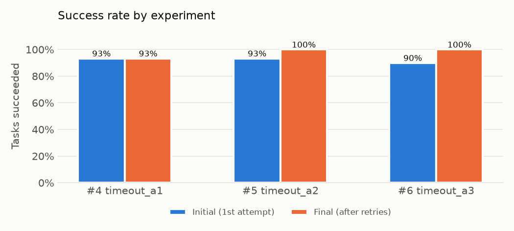
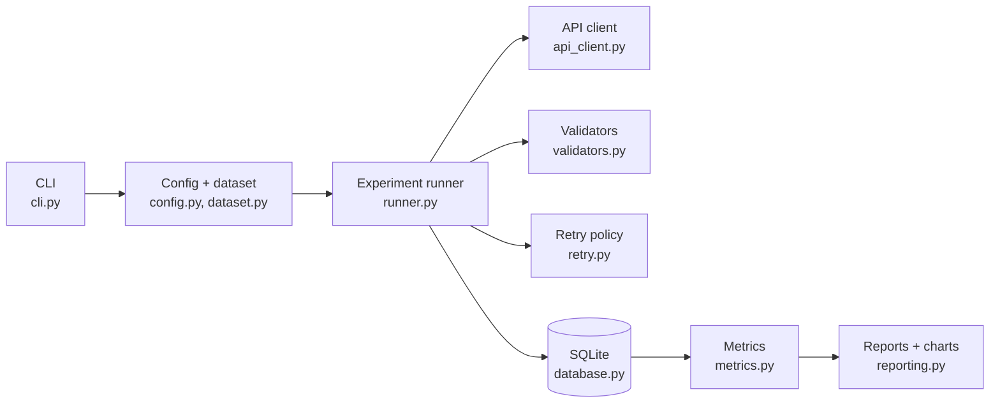

# AI API Reliability Tester

A Python CLI that measures how reliable an AI API is, through controlled and reproducible experiments: does each request succeed, why does it fail, is the answer usable and correct, how long does it take, and can retrying recover failures, at what cost?

**Research question:** how does bounded retry behavior affect the reliability and latency of AI API requests?

## Key results

Six experiments, 30 tasks each, `minimax/minimax-m3.1-flash:free` via OpenRouter. Full analysis: [docs/results.md](docs/results.md).

| Config | Timeout | Max attempts | Initial → final success | Attempts/task | Task latency P95 |
|---|---|---|---|---|---|
| baseline | 20 s | 1 | 100 % → 100 % | 1.00 | 1.53 s |
| retry_1 | 20 s | 2 | 100 % → 100 % | 1.00 | 5.78 s |
| retry_2 | 20 s | 3 | 96.7 % → 96.7 % | 1.00 | 4.29 s |
| timeout_a1 | 1.5 s | 1 | 93.3 % → 93.3 % | 1.00 | 1.82 s |
| timeout_a2 | 1.5 s | 2 | 93.3 % → **100 %** | 1.07 | 2.78 s |
| timeout_a3 | 1.5 s | 3 | 90.0 % → **100 %** | 1.10 | 3.39 s |

- Under a normal timeout the API did not fail once in 90 requests, so retry had nothing to do.
- Under a tight timeout, **one retry recovered every timeout (5 of 5)** for 7–10 % more requests.
- The cost appears in the **tail**: mean task latency barely moved (+0.1 s), P95 rose 50–90 %.
- Retry cannot fix wrong answers: the only non-transport failure (a miscounted vowel) is correctly not retried.



## How it works



For every task in the dataset:

```text
send request ──► response or error ──► validate (transport → API → format → correctness)
      ▲                                        │
      └── wait (1s, 2s, 4s…) ◄── retryable failure and attempts left?
                                               │
                                     store every attempt in SQLite
```

The runner only coordinates; each module does one job. The API client normalizes every outcome into one of 11 failure types (`TIMEOUT`, `RATE_LIMIT`, `SERVER_ERROR`, `FORMAT_ERROR`, `VALIDATION_ERROR`, …), the retry policy decides from the failure type alone, and metrics are computed from stored attempts, so any run can be re-analysed later.

## Setup

Requires Python 3.12+ and an API key for any OpenAI-compatible endpoint (OpenAI, OpenRouter, Groq, local Ollama, …).

```bash
python -m venv .venv
.venv\Scripts\Activate.ps1         # Windows PowerShell
# source .venv/Scripts/activate    # Git Bash;  source .venv/bin/activate on macOS/Linux
pip install -e ".[dev]"
cp .env.example .env               # then put your API key in .env
pytest                             # 200+ tests against fake APIs, no network
```

## Usage

```bash
python -m tester validate -c config/baseline.yaml               # check config + dataset, no API calls
python -m tester probe    -c config/baseline.yaml -t json_001   # one real request, printed
python -m tester run      -c config/baseline.yaml               # full run (--limit N to debug)
python -m tester list                                           # stored experiments
python -m tester summary  -e baseline                           # metrics of latest 'baseline' (or an id)
python -m tester compare  baseline retry_1 retry_2              # side-by-side table + charts
python -m tester export   -e 5                                  # rebuild a report folder from the DB
```

Every run writes `results/<date>_<name>_<id>/` with `config.yaml`, `results.csv` (one row per attempt), `results.json`, `summary.json`, `report.md` and four charts. All attempts also go to `results/experiments.db`.

An experiment is one YAML file:

```yaml
name: timeout_a2
model:
  name: minimax/minimax-m3.1-flash:free
  base_url: https://openrouter.ai/api/v1
request: {temperature: 0.2, max_tokens: 500, timeout_seconds: 1.5}
test: {requests: 30, min_interval_seconds: 3.5}
retry: {enabled: true, max_attempts: 2, backoff_seconds: 1,
        retry_on: [TIMEOUT, CONNECTION_ERROR, RATE_LIMIT, SERVER_ERROR]}
validation: {type: exact_match}
```

## Documentation

| Document | Contents |
|---|---|
| [docs/results.md](docs/results.md) | Analysis of the six experiments |
| [docs/test_protocol.md](docs/test_protocol.md) | Design, controlled variables, procedure, reproduction |
| [docs/metrics.md](docs/metrics.md) | Exact definition of every metric, failure type and validator |
| [docs/limitations.md](docs/limitations.md) | What the results can and cannot support |

## Layout

```text
src/tester/
  cli.py          commands: validate, probe, run, list, summary, compare, export
  config.py       YAML loading          models.py      shared Pydantic models
  dataset.py      task loading + hash   api_client.py  httpx client, failure taxonomy
  validators.py   4 validators          retry.py       retry policy + backoff
  runner.py       attempt / task / experiment levels
  database.py     SQLite storage        metrics.py     reliability metrics
  reporting.py    CSV/JSON/Markdown + matplotlib charts
tests/            pytest suite, fake APIs only
config/           experiment YAML files
datasets/         prompts.json, 30 fixed tasks
docs/             analysis and documentation
results/          experiment outputs (git-ignored)
```

## Testing

```bash
pytest
```

Tests use fake API clients (`httpx.MockTransport` and scripted clients) and never call the network. They cover config validation, dataset checks, every HTTP and transport failure mapping, all validators, all retry paths (fail→pass, fail→fail→pass, exhausted, non-retryable), SQLite round-trips, metrics against hand-computed values, report output and the full CLI workflow.

## Security

API keys live only in `.env`, which is git-ignored, and are read through `python-dotenv`. Keys and `Authorization` headers are never logged or stored; error messages are scrubbed of the key before they are saved.

## Status

Phases 0–11 complete: setup, configuration, dataset, API client, validation, runner, SQLite, retry, metrics and reporting, CLI, controlled experiments, analysis and documentation.

Not implemented (see [limitations](docs/limitations.md)): concurrent execution, a second model comparison, jitter and `Retry-After` handling.
