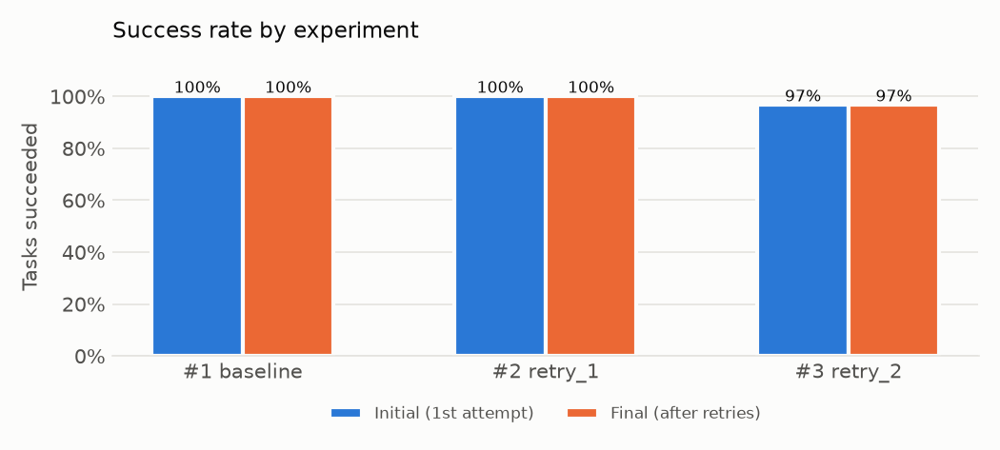
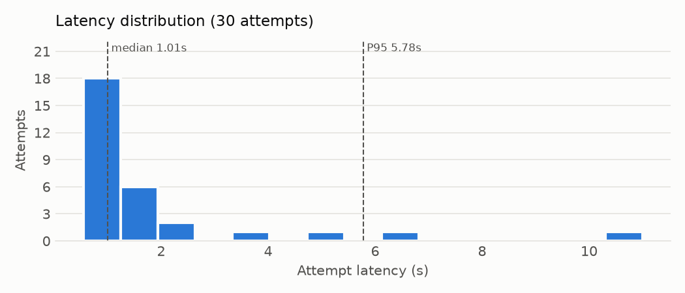
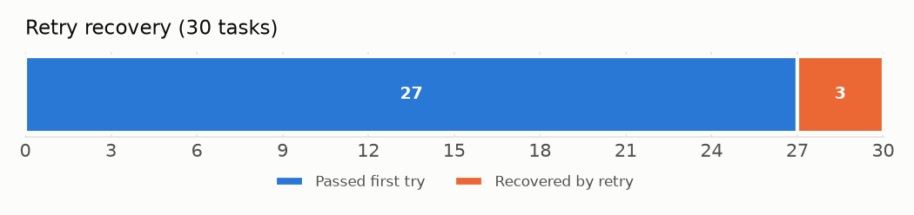
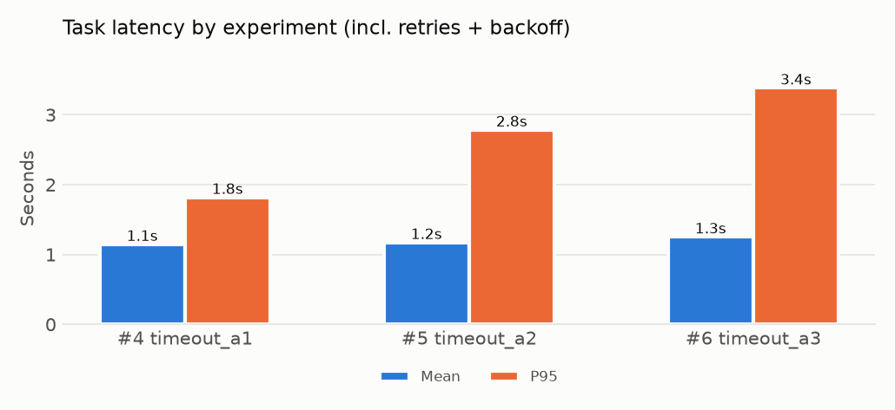

# Results

Six experiments, 2026-10-21, `minimax/minimax-m3.1-flash:free` via OpenRouter, 30 tasks each, 185 requests in total. Procedure: [test_protocol.md](test_protocol.md). Metric definitions: [metrics.md](metrics.md).

## Summary

1. **Under a normal 20 s timeout the API was fully reliable**: 90 requests, zero transport or API failures. Retry configs had nothing to recover and cost nothing.
2. **With a tight 1.5 s timeout, 7–10 % of first attempts timed out, and one retry recovered every one of them** (5 of 5), raising final success from 93.3 % to 100 %.
3. **Retry's cost is in the tail, not the average**: mean task latency rose 0.1 s, but P95 rose from 1.8 s to 2.8–3.4 s, and API attempts rose 7–10 %.
4. **The only non-transport failure was a wrong answer** (1 of 178 validated responses), which retry correctly does not attempt to fix.

## Experiment group A: normal timeout (20 s)

| | #1 baseline | #2 retry_1 | #3 retry_2 |
|---|---|---|---|
| Max attempts | 1 | 2 | 3 |
| Initial / final success | 100 % / 100 % | 100 % / 100 % | 96.7 % / 96.7 % |
| Attempts per task | 1.00 | 1.00 | 1.00 |
| Attempt latency median | 0.88 s | 1.01 s | 0.98 s |
| Attempt latency mean / P95 | 1.02 / 1.53 s | 1.84 / 5.78 s | 1.44 / 4.29 s |
| Slowest response | 2.34 s | 11.00 s | 6.21 s |
| Tokens | 7,279 | 7,390 | 7,230 |
| Final failures | none | none | `VALIDATION_ERROR` ×1 |

**No transport failures occurred**, so the retry setting could not change anything: attempts per task stayed at exactly 1.00 in all three runs. Differences between these runs are not caused by retry.

**Latency varied between runs even though nothing was retried.** The median stayed near 1 s, but the tail moved a lot: P95 was 1.53 s in run #1 and 5.78 s in run #2, two minutes later. This is provider-side variance. It matters for interpreting group B: a timeout of a few seconds lands inside the normal tail.

**The one failure was the model, not the API.** In run #3, `transform_005` ("count the vowels in 'experiment'", expected 4) returned `3`. The same task passed in the other five runs. It is classified `VALIDATION_ERROR` and is not retried: retrying wrong answers would measure sampling luck, not transport reliability.

## Experiment group B: short timeout (1.5 s)

The timeout is set at run #1's P95 latency, so the slowest responses become `TIMEOUT` failures.

| | #4 timeout_a1 | #5 timeout_a2 | #6 timeout_a3 |
|---|---|---|---|
| Max attempts | 1 | 2 | 3 |
| Initial success | 93.3 % (28/30) | 93.3 % (28/30) | 90.0 % (27/30) |
| **Final success** | **93.3 %** | **100 %** | **100 %** |
| Recovered by retry | – | 2 of 2 | 3 of 3 |
| Attempts per task | 1.00 | 1.07 | 1.10 |
| Task latency mean | 1.15 s | 1.17 s | 1.25 s |
| **Task latency P95** | **1.82 s** | **2.78 s** | **3.39 s** |
| Slowest task | 2.21 s | 4.26 s | 3.69 s |
| Tokens | 6,859 | 7,302 | 7,305 |

### Q1. Which failures occurred?

Only `TIMEOUT` (7 attempts across the three runs). No rate limits, server errors or connection errors, which is expected: pacing kept the client under the account rate limit.

Timed-out tasks: `text_002`, `schema_003` (#4); `text_008`, `json_004` (#5); `text_008`, `text_009`, `json_004` (#6). Mostly different tasks each run, which points to **transient** slowness rather than tasks that are inherently slow. `text_008` and `json_004` timed out twice, so some prompts may sit closer to the limit.

### Q2. How many failures did retry recover?

**All of them: 5 of 5, each on the second attempt.** The third attempt allowed in #6 was never used. At this failure rate, one retry was enough.

### Q3. What did retry cost?

| Cost | No retry (#4) → retry (#5, #6) |
|---|---|
| API attempts | +7 % / +10 % |
| Tokens | ≈ +6 % (timed-out requests report no tokens, so failures were "free") |
| Mean task latency | +0.02 s / +0.10 s |
| P95 task latency | +0.96 s / +1.57 s (+53 % / +86 %) |

A recovered task took 3.2–4.3 s: the 1.5 s timeout, the 1 s backoff, then a normal ~1 s response. Retry converts a fast failure into a slow success. That is invisible in the mean (most tasks never retry) and dominant in the P95.

## Latency by task category

Successful responses across all six runs:

| Category | n | Median | Mean | P95 | Output tokens (avg) |
|---|---|---|---|---|---|
| classification | 30 | 0.91 s | 0.93 s | 1.39 s | 3.4 |
| structured_output | 59 | 0.96 s | 1.18 s | 2.21 s | 23.7 |
| simple_text | 59 | 1.14 s | 1.31 s | 2.16 s | 17.1 |
| transformation | 30 | 0.94 s | 1.54 s | 4.35 s | 16.6 |

Classification (a one-word answer) is fastest and most consistent. Medians are similar across categories (≈1 s), so the differences are in the tails. Input tokens (~220–235 per request) are dominated by provider-side overhead, not the prompts.

## Answer to the research question

> How does bounded retry behavior affect the reliability and latency of AI API requests?

**When failures are transient, a single bounded retry recovers them almost completely, at a small average cost but a large tail-latency cost.** In these runs one retry turned 93 % into 100 % final success for 7–10 % more requests, with mean latency nearly unchanged and P95 latency up 50–90 %. Extra retries beyond the first added nothing. When the API is not failing (group A), retry has no effect at all. And retry cannot fix wrong answers, which need different handling (validation-aware retry, or a better prompt or model).

Practical reading: **retry once, set the timeout from observed latency (above the normal tail), and judge the policy by P95, not the mean.**

How far these findings generalize is limited by sample size, a single model and time of day: see [limitations.md](limitations.md).

## Earlier observation (excluded from the analysis)

During development the first model tried, `google/gemma-4-31b-it:free`, returned HTTP 429 "temporarily rate-limited upstream" on **every** request over about an hour (24 attempts, including retries with 1 s backoff). Those runs were deleted before the final experiments and are not counted above. They show the opposite case to group B: when a failure is **persistent** (an overloaded shared pool), short-backoff retry recovers nothing and only multiplies requests.
